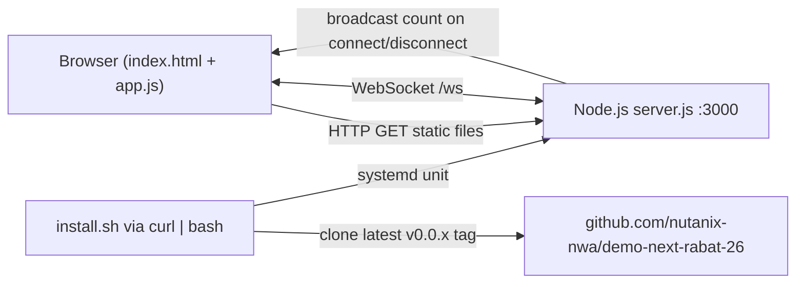

# Demo application deployed by Jarvis - Nutanix Rabat 2026

Landing page for the Nutanix live event in **Rabat, Morocco on Dec 1, 2026**: *"Demo application deployed by Jarvis using Nutanix MCP Server & NAI"*.

The page shows:

- The event hero: **LIVE EVENT** badge, title, *using Nutanix MCP Server & NAI*, location and date.
- A visual of **Nutanix NAI** (AI Assistant) + **Nutanix NKP** (Kubernetes Platform) as glass cards, with the *Simple / Secure / Scalable / Enterprise Ready* feature row.
- A **live counter of connected users**, updated in real time for everyone viewing the page.
- The running app version in the footer.

## How it works

A small Node.js server serves the static page and keeps a WebSocket connection open with every browser. Each time a visitor connects or leaves, the server broadcasts the new total to all open pages. A 30-second ping drops dead connections so the count stays accurate.



| Endpoint       | Description                                  |
| -------------- | -------------------------------------------- |
| `/`            | The web page                                 |
| `/ws`          | WebSocket, pushes `{ "users": <n> }`         |
| `/api/users`   | Current connected-users count (JSON)         |
| `/api/version` | App version from `package.json` (JSON)       |
| `/healthz`     | Health check, returns `{ "status": "ok" }`   |

## Project structure

```
.
├── server.js            Node.js HTTP + WebSocket server
├── package.json         Version and dependencies (only `ws`)
├── public/
│   ├── index.html       Page markup
│   ├── styles.css       Design (dark purple theme, glass cards, responsive)
│   ├── app.js           WebSocket client, live counter, auto-reconnect
│   └── favicon.svg
├── install.sh           One-line installer for Rocky Linux
└── scripts/release.sh   Version bump, tag and prune old releases
```

## Run locally

Requires Node.js 18 or newer.

```bash
npm install
npm start
```

Open <http://localhost:3000>. Open it in a second tab to watch the counter go up. Use another port with `PORT=8080 npm start`.

## Install on Rocky Linux

On a Rocky Linux 8, 9 or 10 VM, run as a user with sudo:

```bash
curl -fsSL https://raw.githubusercontent.com/nutanix-nwa/demo-next-rabat-26/main/install.sh | sudo bash
```

Options are passed as environment variables:

```bash
# Install a specific version on a custom port
curl -fsSL https://raw.githubusercontent.com/nutanix-nwa/demo-next-rabat-26/main/install.sh | sudo VERSION=0.0.2 PORT=8080 bash
```

| Variable   | Default                                                | Description                |
| ---------- | ------------------------------------------------------ | -------------------------- |
| `VERSION`  | latest `v*` tag (falls back to `main` if none)         | Release to install         |
| `PORT`     | `3000`                                                 | Port the app listens on    |
| `REPO_URL` | `https://github.com/nutanix-nwa/demo-next-rabat-26.git` | Repository to install from |

What the script does:

1. Checks it runs as root on Rocky Linux (other EL distributions get a warning).
2. Installs `git`, `curl`, `tar` and Node.js 20 with `dnf` (skipped if Node.js 18+ is already present).
3. Resolves the version to install and clones that tag.
4. Creates the system user `demoapp` and installs the app in `/opt/demo-next-rabat-26` (`npm ci --omit=dev`).
5. Creates, enables and starts the systemd service `demo-next-rabat-26` (starts at boot, restarts automatically on failure) and verifies it is enabled.
6. Opens the port in firewalld if firewalld is running.
7. Waits for `/healthz` to respond and prints the URL, e.g. `http://192.168.1.50:3000`.

**Upgrade:** run the same command again; it installs the latest release and restarts the service. To roll back, run it with `VERSION=<older version>`.

## Operations

```bash
sudo systemctl status demo-next-rabat-26
sudo systemctl restart demo-next-rabat-26
sudo journalctl -u demo-next-rabat-26 -f
curl http://127.0.0.1:3000/healthz
```

### Start on boot

The installer enables the `demo-next-rabat-26` systemd service, so the app starts automatically when the VM boots (after the network is up). If the app crashes, systemd restarts it after 5 seconds and keeps retrying indefinitely.

```bash
# Check autostart is enabled (prints "enabled")
systemctl is-enabled demo-next-rabat-26

# Test: reboot, then from any machine
sudo reboot
curl http://<vm-ip>:3000/healthz

# Disable / re-enable autostart
sudo systemctl disable demo-next-rabat-26
sudo systemctl enable demo-next-rabat-26
```

Uninstall:

```bash
sudo systemctl disable --now demo-next-rabat-26
sudo rm -f /etc/systemd/system/demo-next-rabat-26.service
sudo systemctl daemon-reload
sudo rm -rf /opt/demo-next-rabat-26
sudo userdel demoapp
sudo firewall-cmd --permanent --remove-port=3000/tcp && sudo firewall-cmd --reload
```

## Versioning and releases

Versions follow `MAJOR.MINOR.PATCH` starting at `0.0.1`, and each release is a git tag `vX.Y.Z`. **Only the 4 most recent releases are kept**; older tags are deleted locally and on GitHub.

From a clean `main` branch:

```bash
./scripts/release.sh          # 0.0.1 -> 0.0.2
./scripts/release.sh minor    # 0.0.2 -> 0.1.0
./scripts/release.sh major    # 0.1.0 -> 1.0.0
```

The script bumps `package.json`, commits `release vX.Y.Z`, tags, pushes the branch and tag, then prunes the older tags.

## Troubleshooting

- **Page not reachable from another machine:** check the port is open with `sudo firewall-cmd --list-ports`, and that no cloud or hypervisor firewall blocks it.
- **Installer says the app did not respond:** read the logs with `sudo journalctl -u demo-next-rabat-26 -e`. A common cause is another process using the port; reinstall with a different `PORT`.
- **Counter shows "Offline - reconnecting":** the WebSocket can't reach `/ws`. If you put a reverse proxy in front, it must forward WebSocket upgrades (`Upgrade` and `Connection` headers).
- **Clone fails:** the VM needs outbound HTTPS access to github.com, and the repository must be public (or set `REPO_URL` to a reachable mirror).
